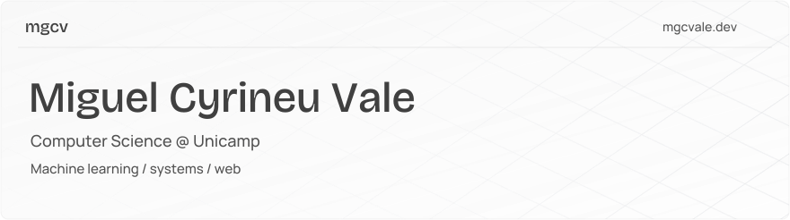

<a href="https://mgcvale.dev">
  <picture>
    <source media="(prefers-color-scheme: dark)" srcset="assets/readme/header-dark.svg">
    
  </picture>
</a>

<h2>
  <picture>
    <source media="(prefers-color-scheme: dark)" srcset="assets/readme/about-dark.svg">
    
  </picture>
</h2>

- I'm a Computer Science student at IC — [Unicamp](https://www.unicamp.br).
- I use [openSUSE Tumbleweed](https://www.opensuse.org) + [Hyprland](https://hyprland.org).
- I'm an IOAI silver medalist (2026, Astana).
- You can find more about me on my [portfolio](https://mgcvale.dev).

<h2>
  <picture>
    <source media="(prefers-color-scheme: dark)" srcset="assets/readme/projects-dark.svg">
    
  </picture>
</h2>

**Status:** `d` in development · `s` stable · `f` finished · `p` paused

- **[Opensync](https://github.com/mgcvale/opensync-backend)** `p` — A streamlined, lightweight, open-source file backup platform, written in C with Kore and SQLite.
- **[JurAI](https://github.com/jurai-git)** `f` — An AI-powered jurisprudence assistant that helps lawyers manage legal research, client interactions, and requests.
- **[Sculpt](https://github.com/mgcvale/sculpt)** `d` — A minimal HTTP server framework providing direct socket access for maximum user control and performance, written in pure C using sockets.
- **[Yami](https://github.com/mgcvale/yami-frontend)** `p` — A social media app for food critics and enthusiasts.
- **[Kore fork](https://github.com/mgcvale/kore)** `s` — A fork of [Jorisvink's Kore](https://github.com/jorisvink/kore) framework, with improvements to file uploads and flexibility.

<h2>
  <picture>
    <source media="(prefers-color-scheme: dark)" srcset="assets/readme/tools-dark.svg">
    
  </picture>
</h2>

<h3>
  <picture>
    <source media="(prefers-color-scheme: dark)" srcset="assets/readme/devops-dark.svg">
    
  </picture>
</h3>

Git, Docker, Linux, C, HPC/Slurm

<h3>
  <picture>
    <source media="(prefers-color-scheme: dark)" srcset="assets/readme/web-dark.svg">
    
  </picture>
</h3>

Spring, Python, FastAPI, PostgreSQL, TailwindCSS, Svelte, NextJS, React, TypeScript

<h3>
  <picture>
    <source media="(prefers-color-scheme: dark)" srcset="assets/readme/data-dark.svg">
    
  </picture>
</h3>

PyTorch, Pandas, Scikit-learn
